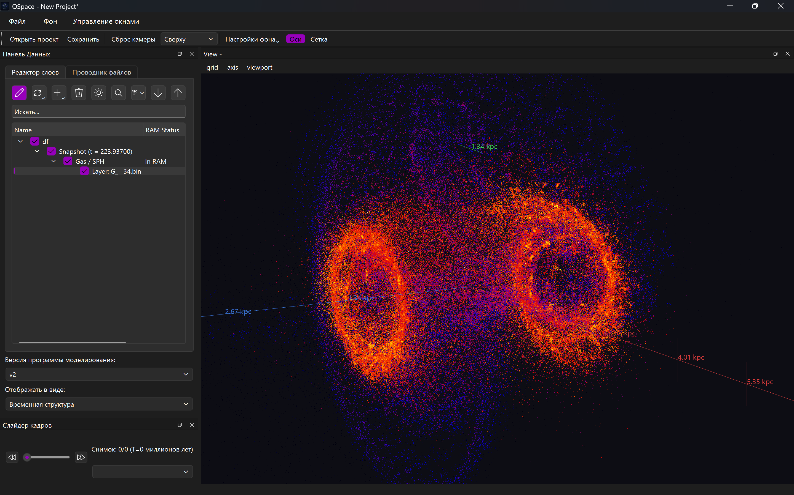

# 🌌 GVis

**High-Performance Desktop Visualizer for Astrophysical Galaxy Simulations & SPH Particle Data**

[](https://isocpp.org/)
[](https://www.qt.io/)
[](https://www.opengl.org/)
[](https://cmake.org/)
[](LICENSE)

[**English**](#-overview) | [**Русский**](#-обзор-проекта-ru)

</div>

---

## 🔭 Overview

**GVis** (*Galaxy Visualizer*) is a native C++20/Qt 6/OpenGL desktop application engineered for interactive 3D exploration and physical analysis of large-scale astrophysical N-body and **Smoothed Particle Hydrodynamics (SPH)** simulations.

Unlike script-based plotting libraries in Python (`matplotlib`, `yt`) that render static frames via code, **GVis** provides real-time interactive visualization powered by kernel splatting, physical weight normalization, and logarithmic transfer functions directly on the GPU via a custom multi-pass OpenGL 3.3 Core pipeline—allowing researchers to rotate, slice, and animate multi-million-particle galaxy evolutions on the fly.

<p align="center">
  
</p>

---

## ✨ Key Features

### 🎨 Multi-Pass GPU Rendering Modes

- **SPH Splatting Layer (`SPHRendererLayer`):**
  - **Pass 1 (Accumulation):** Rasterizes particles into an off-screen `GL_RGBA32F` framebuffer using a 2D Monaghan Cubic Spline kernel ($W(r, h)$ vanishing at $2h$) with additive hardware blending ($\sum A_i W_i$ and $\sum W_i$).
  - **Pass 2 (Physical Resolve):** Performs per-pixel normalization for **Intensive** quantities ($\langle A \rangle = \sum A_i W_i / \sum W_i$ for density, velocity magnitude, internal energy/temperature) and **Extensive** quantities ($\Sigma = \sum m_i W_i$ for surface mass density).
  - **Pass 3 (Color Mapping):** Applies dimensionless-to-physical unit scaling ($M_\odot/\text{pc}^2$, $M_\odot/\text{pc}^3$, $\text{km/s}$, $\text{K}$), safe $\log_{10}$ scaling, density gamma correction ($\gamma$), and 1D floating-point colormap lookup.
- **2D Spatial Binning Layer (`BinningRendererLayer`):** Projects particles onto a configurable resolution grid (`cellSize`) with optional world-space grid overlay and radial distance fading.
- **Direct Particle Layer (`ParticleRendererLayer`):** High-speed point-sprite rendering with optional pseudo-spherical shading ($\sqrt{1 - r^2}$), scalar-driven point sizing, and Alpha/Additive blending.

### ⚡ Memory & I/O Architecture for Large Datasets

- **O(1) LRU Snapshot Cache (`ObjectRegistry` + `DataCache`):** Keeps lightweight metadata (`DataNode`) in the project tree while bounding active datasets in RAM (`cacheCapacity = 30`), automatically evicting least-recently-used snapshots.
- **Sliding-Window Timeline Prefetching (`VideoController`):** Asynchronously preloads a $\pm 5$ snapshot window around the current timeline position using prioritized thread pools (`Urgent` vs. `Bulk` in `TaskManager`) and memory-mapped I/O.
- **Reference Snapshot Locking ("Etalon Frame"):** Lock visual settings, colormaps, and scalar ranges to a reference snapshot while scrubbing through millions of years of galaxy evolution.
- **Customizable File Schemas (`FileSchemeRegistry`):** Built-in binary presets for multi-component simulations (**Gas**, **Stars**, **Dark Matter**) with configurable column mappings, header byte offsets, and interleaved layouts (custom user overrides in development).

### 🖥️ Scientific UI & Session Management

- **Dual-Hierarchy Layer Explorer (`DataTreeModel`):** Switch seamlessly between **Snapshot View** (*Experiment $\rightarrow$ Time Step $\rightarrow$ Matter Component $\rightarrow$ Render Layer*) and **Component View** (*Experiment $\rightarrow$ Gas/Stars/DM $\rightarrow$ Snapshots*).
- **Physical Units Converter (`PhysicalUnits`):** Converts simulation code units into physical astrophysical units ($L_r$ in $\text{kpc}$, $L_v$ in $\text{km/s}$, $\Sigma$ in $M_\odot/\text{pc}^2$, $\rho$ in $M_\odot/\text{pc}^3$, $T$ in $\text{K}$, $t$ in $\text{Myr}$) via `.ini` experiment profiles ($K_m, K_r, \gamma$).
- **Custom Colormap Studio (`ColorMapEditorDialog`):** Built-in presets (*Viridis, Inferno, Plasma, Magma, CoolToWarm, Rainbow, Grayscale, BWR*) plus an interactive gradient editor with JSON import/export and synchronized `QCustomPlot` colorbars.
- **Reflection-Driven Sessions (`.gvs` / JSON):** Full project state serialization (experiments, multi-viewport layouts, camera states, layer settings, and custom palettes) powered by Qt's `QMetaObject` reflection.

---

## 🏗️ Project Architecture

```text
GVis/
├── app/GVisDesktop/       # Application entry point, QSS styling & i18n initialization
├── Common/                  # Shared enums, interfaces (IReader, IRenderLayer), DTOs & Logger
├── Core/
│   ├── AppCore/             # Application controllers (Import, Layer, View, Video, Project, Experiment)
│   ├── DataManager/         # Asynchronous single & batch I/O dispatcher
│   ├── ObjectRegistry/      # Experiment/Snapshot/DataNode hierarchy & O(1) LRU RAM cache
│   ├── FileSchemeRegistry/  # Binary column mapping schemas & preset registry
│   ├── LayerManager/        # Render layer lifecycle & master-node synchronization
│   ├── ViewManager/         # Multi-viewport management & camera synchronization
│   ├── SessionManager/      # Project (.gvs/JSON) & palette persistence
│   └── TaskManager/         # Prioritized QThreadPool execution (Compute, Urgent IO, Bulk IO)
├── IO/                      # Binary readers, INI unit parser & scheme presets
├── Models/DataTreeModel/    # Dual-mode QAbstractItemModel (SnapshotView / ComponentView)
├── Physics/                 # Code-to-physical unit converters & metadata calculators
├── Session/                 # Generic C++20/Qt meta-object reflection serializer
├── UI/Home/                 # MainWindow, LayerExplorer, PropertyInspector, TimeLine, Colorbar
└── Visualize/
    ├── ColorMapManager/     # Shared 1D OpenGL texture cache & gradient presets
    ├── Layers/              # OpenGL 3.3 Core renderers: SPH, Particle, Binning
    └── Views/               # 3D OpenGL viewport, AxisRenderer, GridRenderer & Colorbar widget

```

---

## 🚀 Getting Started

### Prerequisites

- **Compiler:** C++20 compatible compiler (GCC 13+, Clang 16+)
- **Qt:** Qt 6.11+ (`Core`, `Gui`, `Widgets`, `OpenGL`, `OpenGLWidgets`, `Concurrent`, `PrintSupport`)
- **Build System:** CMake 3.25+
- **Dependencies:** VTK (PointData/DataSet containers), QCustomPlot, OpenGL 3.3+ capable GPU

### Build Instructions

```bash
# 1. Clone the repository
git clone [https://github.com/Codbrain1/GVis.git](https://github.com/Codbrain1/GVis.git)
cd GVis

# 2. Configure with CMake
cmake -B build -DCMAKE_BUILD_TYPE=Release

# 3. Build the executable
cmake --build build --parallel

```

---

## 🎮 Controls & Shortcuts (3D Viewport)

| Input                       | Action                                          |
| --------------------------- | ----------------------------------------------- |
| **Left Mouse Drag**         | Orbit camera around target center (Yaw / Pitch) |
| **Shift + Left Mouse Drag** | Pan camera in screen plane                      |
| **Ctrl + Left Mouse Drag**  | Roll camera around view axis                    |
| **Mouse Wheel**             | Zoom in / out                                   |

---

# 🌌 Обзор проекта (RU)

**GVis** — высокопроизводительное десктопное приложение на C++20, Qt 6 и OpenGL 3.3 Core для интерактивной 3D-визуализации и физического анализа результатов астрофизического моделирования галактик и **SPH-данных (Smoothed Particle Hydrodynamics)**.

### Ключевые возможности

1. **Трёхпроходный GPU-конвейер SPH-рендеринга:**
   - Накопление сглаженных физических величин во внеэкранный буфер (`GL_RGBA32F`) с кубическим сплайн-ядром Монагана ($2h$).
   - Честная физическая нормировка интенсивных ($\rho, |v|, u, T$) и экстенсивных ($\Sigma$) полей в экранном пространстве.
   - Динамическое логарифмирование ($\log_{10}$), гамма-коррекция, отсечение частиц по диапазону/индексам и понижение разрешения FBO (`accumResolutionScale`) для плавного FPS на миллионах частиц.

2. **Три режима отображения слоёв:** сглаженный гидродинамический рендеринг (**SPH**), пространственная растеризация по ячейкам (**Binning**) и дискретные частицы со сферическим затенением (**Particles**).
3. **Умное управление памятью (LRU-кэш + скользящее окно):** в оперативной памяти хранятся только активные снимки (`m_cacheCapacity = 30`), а при прокрутке таймлайна соседние кадры ($\pm 5$ шагов) подгружаются асинхронно в фоновых пулах потоков.
4. **Перевод в физические единицы:** автоматический пересчёт безразмерных код-единиц симуляции в килопарсеки ($\text{kpc}$), $\text{км/с}$, $M_\odot/\text{пк}^2$, $M_\odot/\text{пк}^3$, Кельвины ($\text{K}$) и миллионы лет ($\text{Myr}$) на основе `.ini`-профиля эксперимента.
5. **Фиксация эталонного кадра:** настройка палитры, прозрачности и диапазонов по выбранному снимку с автоматическим применением ко всем временным шагам анимации.
6. **Сериализация сессий через рефлексию Qt:** сохранение и восстановление всего состояния исследования в файл проекта (`.gvs` / JSON) и экспорт пользовательских цветовых палитр.

---

## 🗺️ Roadmap

- [ ] Complete removal of legacy VTK data containers in favor of a zero-copy native `ParticleDataset` buffer.
- [ ] Per-particle adaptive smoothing length ($h_i = \eta (m_i / \rho_i)^{1/3}$) in the SPH vertex shader.
- [ ] Out-of-the-box ASCII/CSV and HDF5 readers for *GADGET-4*, *IllustrisTNG*, and *SWIFT* snapshots.
- [ ] Direct FFmpeg / `QOpenGLWidget::grabFramebuffer()` MP4 video export pipeline.

---

## 🤝 Contributing & License

Contributions, bug reports, and feature requests are welcome! Feel free to open an issue or submit a pull request.

Distributed under the **GNU General Public License v3.0 (GPLv3)**. See `LICENSE` for more information.

## 📌 Citation

If you use **GVis** in your academic research or publications, please cite it as follows:

```bibtex
@software{GVis2026,
  author = {Shorkin Maxim},
  title = {GVis: High-Performance Desktop Visualizer for Astrophysical Galaxy Simulations},
  year = {2026},
  url = {[https://github.com/Codbrain1/GVis](https://github.com/Codbrain1/GVis)}
}
